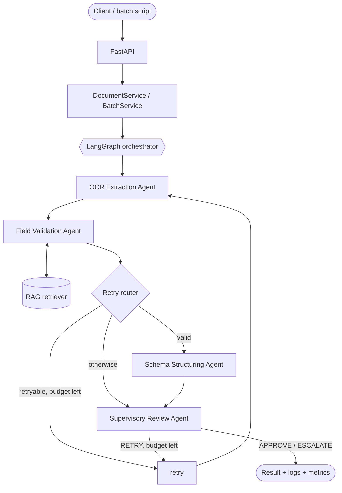

# Multi-Agent LLM Document Intelligence Pipeline

A four-agent **LangGraph** pipeline that turns scanned business documents (invoices,
receipts) into validated, schema-checked records. Each document's fields are checked
against reference data retrieved through **RAG**. Unreadable scans are re-run a
limited number of times, and anything uncertain is routed to supervisory (human)
review. It ships as a **FastAPI** service with a batch engine, structured JSON logs,
metrics, Docker and GitHub Actions CI.

**Runs fully offline.** Every external dependency (LLM, OCR engine, vector database)
sits behind an adapter with a deterministic offline implementation. Clone, `pip install`,
`pytest`, demo, `docker compose up`: none of these need an API key.

## Problem

Accounts-payable and back-office teams receive scanned invoices and receipts in
inconsistent layouts and quality. Typing them in by hand is slow, but blind automation
is risky in three ways:

* OCR misreads characters (`O` ↔ `0`, `l` ↔ `1`), producing plausible-looking garbage.
* LLMs can return malformed JSON or quietly "fix" a value.
* A document can be perfectly readable and still wrong for the business: wrong
  billing currency, an amount above the customer's approval limit, an ID that belongs
  to a different customer.

The pipeline aims to **auto-approve only what it can justify**, re-scan when the scan
is the likely problem, and escalate everything else with concrete reasons.

## Architecture



| Agent | Responsibility |
|---|---|
| **OCR Extraction** ([ocr_agent.py](app/agents/ocr_agent.py)) | Runs OCR through the adapter. On retries it passes `attempt`, which enables heavier preprocessing. Normalizes text (NFKC, control characters, whitespace) and extracts candidate fields from `Label: value` lines. |
| **Field Validation** ([validation_agent.py](app/agents/validation_agent.py)) | Deterministic checks: required fields, dates, amount formats, subtotal + tax = total, ISO currency, ID formats. **RAG checks** against reference data: customer ID ↔ name, billing currency, approval limit. Marks each issue as retryable or not. |
| **Schema Structuring** ([structuring_agent.py](app/agents/structuring_agent.py)) | Asks the LLM for a `DocumentRecord` via structured output. The result is rejected if it fails Pydantic validation, or if the LLM altered a value validation already verified. Attempts are capped; after that the document goes to the supervisor. |
| **Supervisory Review** ([supervisor_agent.py](app/agents/supervisor_agent.py)) | A deterministic policy decides `APPROVE` / `RETRY` / `ESCALATE` with reasons. The LLM reviews the same evidence. The final decision is the **more conservative** of the two: the LLM can escalate, never approve something the policy escalated. |

More detail: [docs/architecture.md](docs/architecture.md) · [docs/pipeline.md](docs/pipeline.md).

## Workflow, retry and escalation

```
OCR → Validation → valid? ── yes → Structuring → Supervisor → APPROVE / ESCALATE
                     │                               │
                     no (retryable, retries left)    RETRY (low confidence, retries left)
                     ↓                               ↓
                   Retry → OCR (enhanced) → Validation → ... → max retries → Supervisor → ESCALATE
```

* **What gets retried** depends on *why* validation failed:
  * Format errors (garbled dates/amounts/IDs) are always retried.
  * Content errors (missing field, totals don't add up) are retried only when OCR confidence was low.
  * Conflicts with reference data are never retried, because re-scanning can't fix them.
* **Hard limits:**
  * `MAX_RETRIES` (default 2, validated range 0–5) caps re-scans.
  * `MAX_STRUCTURING_ATTEMPTS` caps LLM attempts.
  * LangGraph's `recursion_limit` is a third, independent backstop. A test swaps in a deliberately broken router and shows the run still terminates (as a `failed` result).
* **Visible:** every transition emits a JSON log line with `document_id`, `correlation_id` and `retry_count`, for example:

```json
{"event": "validation_failed", "document_id": "inv_004", "correlation_id": "3f9c1a2b7d4e",
 "retry_count": 0, "retryable": true,
 "errors": ["document_date: INVALID_DATE - cannot parse date '2O26-05-O7'", "..."]}
```

## Why LangGraph?

* **The control flow is a graph, not a chain.** There are two loops (re-scan, structured-output retry) and three exits. LangGraph models them as explicit conditional edges, so routing lives in small pure functions ([routing.py](app/graph/routing.py)) that are unit-tested branch by branch.
* **Typed shared state.** Every agent reads and writes one `TypedDict`. Additive reducers turn `events`/`errors` into an audit trail.
* **Agents stay plain callables.** They take state and return updates, with dependencies injected. The same agent runs in the graph, in a unit test, or with a different LLM.
* **Built-in safety net.** `recursion_limit` bounds execution even if routing were wrong.

## RAG

The knowledge base holds **reference data, not the documents being processed**:
customer master records (ID, registered name, billing currency, approval limit) and a
short policy handbook ([data/reference/](data/reference/)). The pipeline is chunk → embed
(`EmbeddingProvider`) → store (`VectorStore`) → `Retriever`, and is used for:

* **Metadata-filtered lookup** by customer ID, which maps directly to a Pinecone metadata filter.
* **Semantic lookup** by name, to catch "known customer, wrong ID".
* **Policy retrieval.** Chunks are passed to the supervisor and cited in its reasons.

Business rules are checked against chunk **metadata**, so decisions are deterministic.
The chunk **text** is what a real LLM supervisor reads.

| | Offline (default) | Real |
|---|---|---|
| Embeddings | `HashingEmbeddings`: deterministic lexical hash (word overlap, not meaning) | any LangChain `Embeddings`, e.g. OpenAI |
| Vector store | `InMemoryVectorStore` | `PineconeVectorStore` (index, namespace, metadata filters, top_k; optional index creation) |

If `VECTOR_STORE=pinecone` but `PINECONE_API_KEY` is missing (or the SDK isn't
installed), the app logs a `vector_store_fallback` warning and continues offline.

## Structured outputs

`DocumentRecord` ([schemas/document.py](app/schemas/document.py)) enforces:

* ID patterns
* a positive 2-decimal amount
* a supported currency
* a date that isn't in the future
* "validation errors ⇒ `review_required`"

`LLMAdapter.invoke_structured` validates every LLM response against the requested
schema and raises `StructuredOutputError` otherwise. Malformed output is captured,
retried within `MAX_STRUCTURING_ATTEMPTS`, and then escalated; it is **never silently
accepted**. On top of that, the structuring agent rejects records where the LLM changed
a verified field (amount, date, IDs, currency).

## API

```bash
uvicorn app.main:app --host 127.0.0.1 --port 8000      # interactive docs at /docs
```

| Method | Path | Purpose |
|---|---|---|
| `GET` | `/health` | Status, version, whether running offline, which adapters are active |
| `POST` | `/documents/process` | `{"document_id": "inv_004", "file_path": null}` → full result |
| `POST` | `/documents/batch` | `{"documents": [...], "max_concurrency": 4}` (1–100 docs) → per-document results + summary |
| `GET` | `/documents/{document_id}` | Most recent result for a document (404 if unknown) |
| `GET` | `/metrics` | Processed / successful / escalated / failed / retries / validation failures / latency |

A process response contains: `document_id`, `correlation_id`, `status` (`completed` or
`failed`), `decision`, `document_type`, `extracted_fields`, `validation` (errors and
warnings with codes), `confidence`, `retry_count`, `review_reasons`, `record`, `errors`,
`warnings`, `events`, `processing_ms`.

`file_path` is resolved inside `DOCUMENTS_DIR`. Paths that escape it are rejected (400).
A pipeline exception for one document comes back as `status: "failed"` / `ESCALATE`
rather than a 500.

The API layer ([app/api/](app/api/)) only maps HTTP to the existing services. Processing
is synchronous, which is fine for the offline adapters. With real LLM/OCR latency you
would put a queue in front of it.

## Batch processing

```bash
python scripts/run_batch.py --input data/sample_documents --output results.json
```

* `BatchService` processes each document independently on a thread pool, bounded by `--concurrency` / `BATCH_MAX_CONCURRENCY`.
* Results keep input order.
* One document raising never stops the batch: it is recorded as `failed`.
* The summary reports total, successful (auto-approved), escalated, failed (errors), retries, validation failures, average per-document time and wall-clock time.
* A directory with a `manifest.json` is treated as a mock-OCR sample set. Otherwise every `.txt/.png/.jpg/.tif/.pdf` file is one document.

## Observability

* **Logs:** JSON lines on stderr (`LOG_FORMAT=json|text`). Events include `document_received`, `ocr_completed`, `validation_started`, `rag_retrieval_completed`, `validation_failed`/`validation_passed`, `retry_started`, `structuring_completed`/`structuring_failed`, `supervisor_decision`, `document_completed`/`document_failed`. Field names that look sensitive (`*key*`, `*token*`, `*secret*`…) are redacted, and the Pinecone key is a `SecretStr`.
* **Metrics:** an in-memory, thread-safe store behind `GET /metrics`. It resets on restart and is per-process. A production deployment would export these counters to Prometheus/OpenTelemetry or another centralized backend.

## Offline mode, and what's real vs. mocked

| Component | Offline default (tests, demo, Docker, CI) | Real integration | Tested live? |
|---|---|---|---|
| Orchestration, API, batch, logging | LangGraph, FastAPI, uvicorn (real) | — | Yes |
| LLM | `FakeLLMAdapter` (deterministic, schema-shaped) | OpenAI / Anthropic / Groq via LangChain `with_structured_output` | **No**: adapter tested against a stub chat model |
| OCR | `MockOCRAdapter` (replays fixture text per attempt) | `TesseractOCRAdapter` | **No** |
| Embeddings | `HashingEmbeddings` | LangChain embeddings (OpenAI) | **No** |
| Vector store | `InMemoryVectorStore` | `PineconeVectorStore` | **No**: tested against an in-process fake Pinecone client; the full pipeline gives identical decisions on it |

There are no accuracy, throughput or latency claims here, because none have been measured
on real documents. The demo reports one thing: whether routing matches the hand-labelled
expected decision on 8 synthetic sample documents.

## Setup

Python 3.11+.

```bash
python -m venv .venv
```

```bash
source .venv/bin/activate        # Windows: .venv\Scripts\activate
```

```bash
pip install -r requirements-dev.txt
```

Optional real providers: `pip install -r requirements-optional.txt`, then copy `.env.example`
to `.env` and set e.g. `LLM_PROVIDER=openai`, `LLM_MODEL=<model>`, `VECTOR_STORE=pinecone`,
`PINECONE_API_KEY=...`. Invalid configuration fails at startup with the variable name
(e.g. `MAX_RETRIES: Input should be less than or equal to 5`).

## Demo

```bash
python scripts/demo_pipeline.py
```

This walks five sample documents through every stage (received → OCR → RAG → validation
→ retry → structuring → supervisor → final). It covers a clean approval, a re-scan that
recovers, retry exhaustion → escalation, a RAG policy escalation, and a supervisor-requested
re-scan. Then it starts uvicorn on a free local port and calls `/health`,
`/documents/process`, `/documents/batch` and `/metrics`. It takes a few seconds and needs
no credentials. Options: `--all`, `--no-api`, `--json`, or pass document ids.

| Sample | Scenario | Outcome |
|---|---|---|
| inv_001 | clean invoice | APPROVE |
| inv_002 | receipt, different labels, DD/MM/YYYY, currency from `€` | APPROVE |
| inv_003 | clean scan, customer ID genuinely missing | ESCALATE, no retry |
| inv_004 | noisy scan, clean on re-scan | APPROVE after 1 retry |
| inv_005 | persistently unreadable scan | ESCALATE after 2 retries |
| inv_006 | total over the customer's approval limit (RAG) | ESCALATE |
| inv_007 | currency violates the customer's billing policy (RAG) | ESCALATE |
| inv_008 | valid but low confidence; supervisor requests a re-scan | APPROVE after 1 retry |

## Docker

```bash
docker compose up --build
```

The API is served on `http://localhost:8000`. Set `API_PORT=8080` (for example) to use a different host port.

This builds `python:3.11-slim` with the runtime requirements and runs
`uvicorn app.main:app --host 0.0.0.0 --port 8000` as a non-root user, with a `/health`
healthcheck, offline by default. Real providers: pass env vars through compose. Build
with `--build-arg REQUIREMENTS=requirements-optional.txt` to include their SDKs; Tesseract
would also need the `tesseract-ocr` apt package.

## Testing

```bash
pytest -q
```

The suite is deterministic and offline: no API keys and no network. Layout:

* `tests/unit`: OCR, field extraction, validation rules, schemas, structuring guardrails, supervisor policy, routing, RAG, mocked Pinecone, config, log redaction.
* `tests/integration`: end-to-end graph runs, retry bounds, log trail, batch.
* `tests/api`: FastAPI `TestClient`.

## CI/CD

[.github/workflows/ci.yml](.github/workflows/ci.yml) runs on pushes to `main`, pull
requests, and manual dispatch:

1. **test:** Python 3.11, `pip install -r requirements-dev.txt`, `pytest -q`, a demo smoke run.
2. **docker:** builds the image, starts the container, and calls `/health`, `/documents/process` and `/metrics`.
3. **deploy:** only on `main`. Triggers a Render deploy hook if `RENDER_DEPLOY_HOOK_URL` is set, otherwise skips.

No job needs credentials.

## Project layout

```
app/
  main.py                FastAPI app factory (uvicorn app.main:app)
  api/                   request/response models + routes (HTTP only)
  config.py              env-driven Settings, validated at startup
  observability.py       JSON logging + in-memory metrics
  schemas/               Pydantic models: document, extraction, validation, review
  adapters/              llm.py, ocr.py, vector_store.py: interface + offline + real
  agents/                the four agents
  graph/                 state.py, routing.py, workflow.py
  rag/                   embeddings.py, retriever.py, knowledge_base.py
  services/              document_service.py, batch_service.py
data/
  sample_documents/      8 synthetic "scans" + manifest with expected decisions
  reference/             customer master data + policies (RAG knowledge base)
scripts/                 demo_pipeline.py, run_batch.py
tests/                   unit/, integration/, api/
legacy/                  earlier invoice/PO reconciliation prototype (Streamlit) + its Dockerfile
```

## Limitations

* The real LLM, Tesseract, OpenAI-embedding and Pinecone paths are implemented but not run against live services in this repo.
* Sample data is 8 synthetic text "scans"; there is no evaluation set of real scanned documents yet.
* Results and metrics live in process memory (lost on restart, not shared between replicas).
* The API accepts document ids or paths under `DOCUMENTS_DIR`; there is no file-upload endpoint yet. Processing is synchronous.
