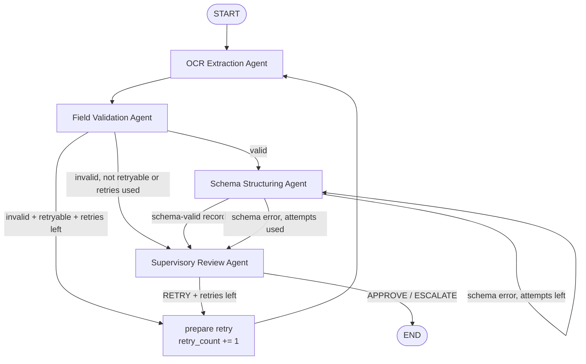

# Multi-Agent LLM Document Intelligence Pipeline

A four-agent **LangGraph** pipeline that turns scanned business documents (invoices,
receipts) into validated, schema-checked records. Fields are checked against
reference data retrieved through **RAG**. Unreadable scans are retried with a fixed
limit, and anything uncertain goes to a supervisory review.

```
OCR Extraction ─► Field Validation ─► Schema Structuring ─► Supervisory Review
      ▲                  │                                        │
      └──── retry ◄──────┴───────── (bounded) ◄───────────────────┘
```

Every external dependency (LLM, OCR engine, vector database) sits behind an adapter.
By default the pipeline runs **fully offline** with deterministic mock/fake adapters,
so you can clone it, run the tests and run the demo with no API keys.

## What is real and what is mocked

| Component | Offline default (used by tests/demo) | Real integration | Real integration tested? |
|---|---|---|---|
| Orchestration | LangGraph `StateGraph` (real) | — | Yes, it is what runs |
| LLM | `FakeLLMAdapter`: deterministic, returns schema-shaped output | `LangChainLLMAdapter` wrapping OpenAI / Anthropic / Groq chat models through `with_structured_output` | Adapter logic tested against a stub chat model. **Not tested against a live API.** |
| OCR | `MockOCRAdapter`: replays fixture text per attempt, with recorded confidence | `TesseractOCRAdapter` (pytesseract, Pillow, pdf2image) | **Not tested against real scans** (test is skipped when pytesseract isn't installed) |
| Embeddings | `HashingEmbeddings`: lexical bag-of-words hash (implements LangChain `Embeddings`) | Any LangChain embedding model, e.g. `OpenAIEmbeddings` | **Not tested live** |
| Vector store | `InMemoryVectorStore` (cosine) | `PineconeVectorStore` | Request/response mapping tested against a fake index. **Not tested against a live Pinecone index.** |

There are no accuracy or latency numbers here, because none have been measured on
real documents. The demo reports one thing: whether the pipeline's routing matches
the hand-labelled expected decision on the 8 synthetic sample documents.

## The four agents

| Agent | File | Responsibility |
|---|---|---|
| **OCR Extraction** | [app/agents/ocr_agent.py](app/agents/ocr_agent.py) | Calls the OCR adapter (with `attempt` = retry count, so retries can use heavier preprocessing). It normalizes text (Unicode NFKC, control characters, whitespace) and pulls candidate fields out of `Label: value` lines using a synonym table. |
| **Field Validation** | [app/agents/validation_agent.py](app/agents/validation_agent.py) | Deterministic checks: required fields, date parsing, amount format, subtotal + tax = total, ISO currency, ID formats. **RAG checks**: customer ID ↔ name, billing currency, approval limit. Returns a typed `ValidationResult`. |
| **Schema Structuring** | [app/agents/structuring_agent.py](app/agents/structuring_agent.py) | Asks the LLM for a `DocumentRecord` through structured output. The result is rejected if it fails Pydantic validation, or if the LLM changed a value that validation already verified (amount, date, IDs, currency). Retries are limited, then the document goes to review. |
| **Supervisory Review** | [app/agents/supervisor_agent.py](app/agents/supervisor_agent.py) | A deterministic policy decides `APPROVE` / `RETRY` / `ESCALATE` with reasons. The LLM reviews the full evidence, and the final decision is the **more conservative** of the two: the LLM can escalate, but it can never approve something the policy escalated. |

## LangGraph workflow

Wiring: [app/graph/workflow.py](app/graph/workflow.py). Routing functions: [app/graph/routing.py](app/graph/routing.py) (pure functions, unit-tested). State: [app/graph/state.py](app/graph/state.py) (a `TypedDict`; `events` and `errors` use an additive reducer to build an audit trail).



### Retry and escalation design

* **Which failures are retried?** Each `ValidationIssue` carries a `retryable` flag:
  * *Format errors* (`2O26-05-O7`, `4,3l0.00`, `U5D`) are always retryable. They are typical OCR misreads.
  * *Content errors* (missing field, totals don't add up, future date) are retryable **only if OCR confidence was below 0.80**. On a clean scan a missing field is genuinely missing, and re-scanning won't fix it.
  * *Reference-data conflicts* (wrong billing currency, ID belongs to another customer) are never retryable.
* **Supervisor RETRY**: a document can pass validation but still have low overall confidence (< 0.75). The supervisor then asks for a re-scan, as long as retries are left.
* **Bounded loops**: OCR retries are capped by `MAX_RETRIES` (default 2). Structuring attempts are capped by `MAX_STRUCTURING_ATTEMPTS` (default 2). The graph's `recursion_limit` is a hard backstop computed from both. A `RETRY` with no retries left becomes `ESCALATE`.

## RAG

[app/rag/](app/rag/): `chunk_text` → `Embeddings` → `VectorStore` → `Retriever`.

The knowledge base is **reference data, not the documents being processed**. It
holds customer master records (ID, registered name, billing currency, approval
limit) and a short policy handbook ([tests/fixtures/reference/](tests/fixtures/reference/)).
It is used for contextual validation and review:

* *Metadata-filtered lookup* by `customer_id` (`{"kind": "customer", "customer_id": ...}`), which maps directly to a Pinecone metadata filter.
* *Semantic lookup* by customer name when the ID is unknown. This catches "known customer, wrong ID".
* *Policy retrieval* for the document type. The chunks are passed to the supervisor as context and cited in its reasons.

Business rules are checked against structured chunk **metadata**, so the decisions
are deterministic. The chunk **text** is what a real LLM supervisor reads.

## Structured output: why it matters here

`DocumentRecord` ([app/schemas/document.py](app/schemas/document.py)) enforces ID patterns, a
positive 2-decimal amount, a supported currency, a date that isn't in the future, and
"validation errors imply `review_required`". `LLMAdapter.invoke_structured` validates
every LLM response against the requested schema and raises `StructuredOutputError`
otherwise. Free-form JSON never gets into the pipeline state.

## Project layout

```
app/
  config.py              Settings (env-driven, offline defaults)
  schemas/               Pydantic models: document, extraction, validation, review
  adapters/              llm.py, ocr.py, vector_store.py: interface + offline + real
  agents/                the four agents
  graph/                 state.py, routing.py, workflow.py
  rag/                   embeddings.py, retriever.py, knowledge_base.py
  services/              document_service.py (single doc), batch_service.py (graph.batch)
scripts/demo_pipeline.py
tests/
  unit/                  per-component tests
  integration/           end-to-end LangGraph runs
  fixtures/documents/    8 sample "scans" + manifest (expected decisions)
  fixtures/reference/    customer master data + policies for RAG
docs/                    architecture.md, pipeline.md
legacy/                  earlier invoice/PO reconciliation prototype (Streamlit)
```

## Setup

Python 3.11+.

```bash
python -m venv .venv
```

```bash
source .venv/bin/activate        # Windows: .venv\Scripts\activate
```

```bash
pip install -r requirements.txt
```

Real integrations are optional: `pip install -r requirements-optional.txt`, then copy
`.env.example` to `.env` and set e.g. `LLM_PROVIDER=openai`, `LLM_MODEL=<model>`,
`VECTOR_STORE=pinecone`, `PINECONE_API_KEY=...`. The Pinecone index dimension must
match the embedding dimension (256 for the hashing embeddings).

## Tests

```bash
pytest -q
```

The suite is deterministic and needs no API keys or network. It covers the OCR adapter and text
normalization, field extraction, every validation rule, the schema validators, the
structuring guardrails (malformed output, tampered values), supervisor decisions and
the LLM-can't-be-lenient rule, every routing branch, RAG chunking/embedding/retrieval,
the Pinecone adapter mapping, and end-to-end graph runs, including bounded retries,
structured-output retry, and batch failure isolation.

## Demo

```bash
python scripts/demo_pipeline.py
```

Sample output (abridged):

```
Document: inv_004  (noisy first scan (O/0, l/1), clean on enhanced re-scan)
  -> OCR completed (engine=mock, attempt=0, confidence=0.58, fields=9)
  -> Validation failed: document_date=INVALID_DATE, total_amount=INVALID_AMOUNT
  -> Retry 1/2: re-running OCR with enhanced preprocessing
  -> OCR completed (engine=mock, attempt=1, confidence=0.91, fields=9)
  -> Validation passed
  -> Structured record created (attempt 1)
  -> Supervisor: APPROVE - all required fields present and valid; ...
  Retry count: 1
  Final decision: APPROVE
```

Use `python scripts/demo_pipeline.py inv_005 inv_006` for specific documents, or `--json` for full results.

| Sample | Scenario | Outcome |
|---|---|---|
| inv_001 | clean invoice | APPROVE |
| inv_002 | receipt, different labels, DD/MM/YYYY, currency from `€` | APPROVE |
| inv_003 | clean scan, customer ID genuinely missing | ESCALATE, no retry |
| inv_004 | noisy scan, clean on re-scan | APPROVE after 1 retry |
| inv_005 | persistently unreadable scan | ESCALATE after 2 retries |
| inv_006 | total over the customer's approval limit (RAG) | ESCALATE |
| inv_007 | currency violates the customer's billing policy (RAG) | ESCALATE |
| inv_008 | valid, but low confidence; supervisor requests a re-scan | APPROVE after 1 retry |

## Batch processing

`BatchService` uses LangGraph's native `graph.batch(...)` with `max_concurrency`.
A document that raises an exception is recorded as `ESCALATE` with the error, and the
rest of the batch keeps going. The sample set is deliberately small; the same code path takes any number
of `DocumentInput`s.

## Not yet included

FastAPI service, a Docker image for this pipeline, and an evaluation dataset of
real scans. `Dockerfile` and the CD step currently deploy the legacy Streamlit
prototype in [legacy/](legacy/). The CI test job runs this pipeline's suite.
