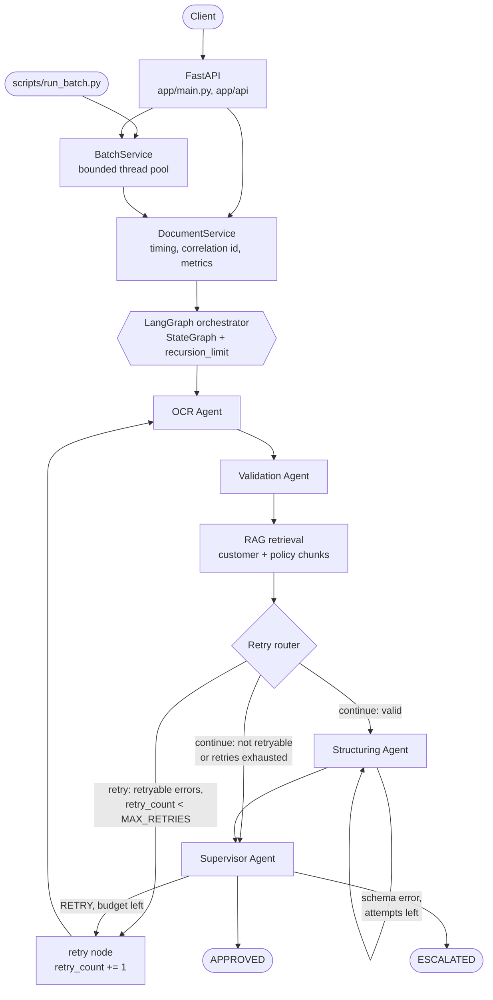
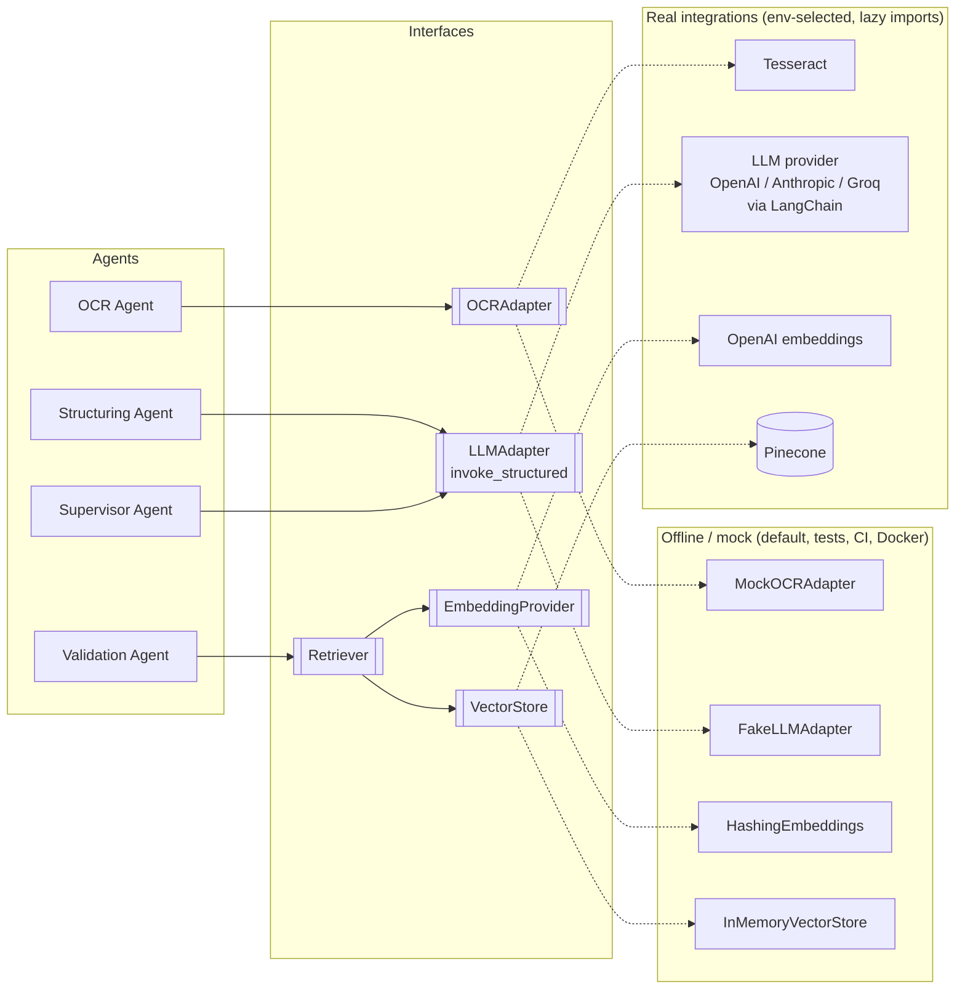

# Architecture

## Request flow

(RAG retrieval happens inside the Validation Agent; it is drawn as its own step for clarity.)

## Adapters: offline vs. real

Selection happens once at startup in the `build_*` factories, from `Settings.from_env()`:

| Variable | Values | Notes |
|---|---|---|
| `LLM_PROVIDER` | `fake` · `openai` · `anthropic` · `groq` | real providers need `LLM_MODEL` (validated) |
| `OCR_PROVIDER` | `mock` · `tesseract` | |
| `VECTOR_STORE` | `memory` · `pinecone` | falls back to `memory` (with a warning) when credentials or the SDK are missing |
| `EMBEDDING_PROVIDER` | `hashing` · `openai` | Pinecone index dimension must equal `EMBEDDING_DIM` |

The graph never imports a provider. It receives adapter instances, so the LLM is
never hard-coded into the workflow.

## Layers

* **`app/schemas`** are the contracts between agents. They are typed Pydantic objects in state.
* **`app/agents`** are plain callables `state -> partial update` with injected dependencies. They don't know about LangGraph or HTTP.
* **`app/graph`** holds wiring (`workflow.py`) and pure routing functions (`routing.py`).
* **`app/services`** contains `DocumentService`, which owns timing, correlation IDs, exception containment and metrics recording, and `BatchService`, which adds bounded concurrency and summary statistics.
* **`app/api`** is the HTTP layer only: request validation, path safety and response mapping.
* **`app/adapters`** are the only modules that touch third-party SDKs, and they import them lazily.
* **`app/observability.py`** holds the JSON log formatter (with redaction) and the in-memory metrics store.

## Design decisions

| Decision | Why |
|---|---|
| Rule-based field extraction in the OCR agent | Scanned business documents are mostly `Label: value`. This is cheap and testable, and keeps the LLM for the parts that need judgement. |
| Deterministic validation; RAG rules on chunk metadata | Validation must be reproducible and auditable. The chunk text is still there for an LLM reviewer. |
| LLM output validated twice | Once against the schema, once against values validation already verified (`LOCKED_FIELDS`). |
| Supervisor = policy + LLM, most conservative wins | The LLM can add caution, never remove it. |
| `retryable` flag per validation issue | Whether to retry depends on *why* validation failed, not just *whether* it failed. |
| Retry counters + `recursion_limit` | Two independent bounds. A test proves the backstop with a deliberately broken router. |
| `process()` never raises | One bad document must not crash an API request handler or a batch. Failures become `status="failed"` results. |
| Thread pool for batches (not `graph.batch`) | Gives per-document timing and error isolation around the whole service call, including code outside the graph. |
| In-memory metrics and result store | Enough for one instance. Production would use Prometheus/OTel and a database. |

## Extending

* **New document type:** add labels to `LABELS`, a prefix to `REFERENCE_NUMBER_PATTERN`, and a section to `data/reference/policies.md`.
* **Another LLM provider:** add a branch to `build_llm`; any LangChain chat model with `with_structured_output` works.
* **Cloud OCR:** subclass `OCRAdapter`.
* **Large knowledge base:** index once offline instead of in `build_retriever` at startup.
